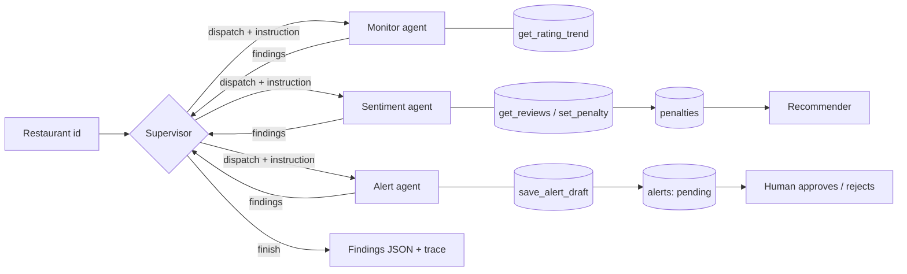

# SmartBite AI

A multi-agent system that watches restaurant quality, catches a decline early, and acts on it.

## Synopsis

**Problem.** Food-delivery and discovery platforms rank restaurants by star rating, which lags behind reality. A restaurant can start serving cold food or get a hygiene complaint, and keep ranking high for weeks. Customers get a bad meal, the platform loses trust, and the owner finds out too late.

**Solution.** SmartBite AI is a team of four LLM agents coordinated by a LangGraph supervisor. The agents inspect a restaurant's recent reviews, decide whether a quality decline is real or just noise, lower the restaurant's recommendation score when it is real, and draft an alert to the owner. A human approves or rejects every alert before it goes anywhere.

**Target user.** Platform operations and trust-and-safety teams who monitor restaurant quality, and restaurant owners who want an early warning.

Dataset: the public Zomato Bangalore restaurants dataset (300 of the most-voted restaurants, about 8,000 reviews). User ids and review dates are synthetic.

## Agents

| Agent | Role | Tools |
|---|---|---|
| **Supervisor** | Decides which agent runs next from the findings so far, re-runs an agent when results disagree or confidence is low, retries after errors, and decides when to finish | structured LLM decision |
| **Monitor** | Judges whether a rating drop is real or noise, using the sample size behind it | `get_rating_trend` |
| **Sentiment** | Reads recent review text to find a decline before the stars show it, and applies a ranking penalty (0.1 to 0.8) when it is confident | `get_reviews`, `set_penalty` |
| **Alert** | Turns confirmed findings into a short owner alert saved as `pending` for human approval. Drafts nothing when evidence is weak | `save_alert_draft` |

The recommender (`tools/recommender.py`) is a normal scoring tool, not an agent. It reads the penalty the Sentiment agent writes, so the agents' decision changes what users see.

## Architecture

Orchestrator-worker pattern. Workers never call each other; every result returns to the Supervisor, which re-plans.



Why multiple agents: the Monitor and the Sentiment agent look at the same restaurant through different evidence (numbers vs text). The Supervisor can only trust a decline when both agree, and it re-runs the less certain one when they do not. One agent doing both would have no one to cross-check it.

Adaptive behaviour (see `docs/sample_trace_healthy.jsonl`): on a healthy restaurant the Supervisor re-ran the Sentiment agent because its confidence was lower than the Monitor's, then finished without drafting an alert. In `docs/sample_trace_decline.jsonl` the full path runs: monitor, sentiment (penalty applied), alert, finish.

Safety limits: a hard `MAX_STEPS` cap, a worker that crashes returns an error to the Supervisor instead of killing the run, a supervisor failure ends the run cleanly, and alerts require human approval.

## Technology

- **LangGraph** for the supervisor/worker graph and shared state
- **LangChain** tool calling and **Groq** (`openai/gpt-oss-120b`) as the LLM, swappable through `lib/llm.py`
- **SQLite** for restaurants, reviews, prices, penalties and alerts
- **scikit-learn** (TF-IDF) for the recommender
- **Streamlit** UI, **pytest** tests

## Input and output

Full schemas and samples are in [docs/DESIGN.md](docs/DESIGN.md).

Input: a restaurant id, for example `2`.

Output (shortened):

```json
{
  "monitor":   [{"restaurant_id": 2, "drop": true, "severity": "high", "confidence": 0.86}],
  "sentiment": [{"restaurant_id": 2, "sentiment": "negative", "trend": "declining", "confidence": 0.86, "penalty_applied": 0.6}],
  "alert":     [{"restaurant_id": 2, "alert_drafted": true, "alert_id": 2}]
}
```

## Run it

```bash
python -m venv venv
venv\Scripts\activate          # Windows
pip install -r requirements.txt

cp .env.example .env           # then put your GROQ_API_KEY in .env

# place the Zomato CSV at data/zomato.csv, then:
python -m lib.load_data        # builds data/smartbite.db

streamlit run app.py           # web UI
python -m agents.graph 2       # or run the agents from the command line
pytest                         # tests (no API key needed)
```

Simulate an incident from the command line:

```bash
python simulator.py bad_reviews 2 --n 10   # inject bad reviews
python simulator.py rating 2 --to 3.0      # change the listed rating
python simulator.py price 2 --pct 25       # raise the price
```

Every message between agents and every tool call is appended to `trace.jsonl`.

## Project layout

```
agents/     supervisor, monitor, sentiment, alert, graph (LangGraph), base (tool-calling loop)
tools/      DB-backed tools and the recommender; lc_tools.py wraps them for the LLM
lib/        db, llm, trace, load_data
tests/      pytest suite
docs/       design document and sample execution traces
app.py      Streamlit UI
simulator.py   injects incidents for demos
```
