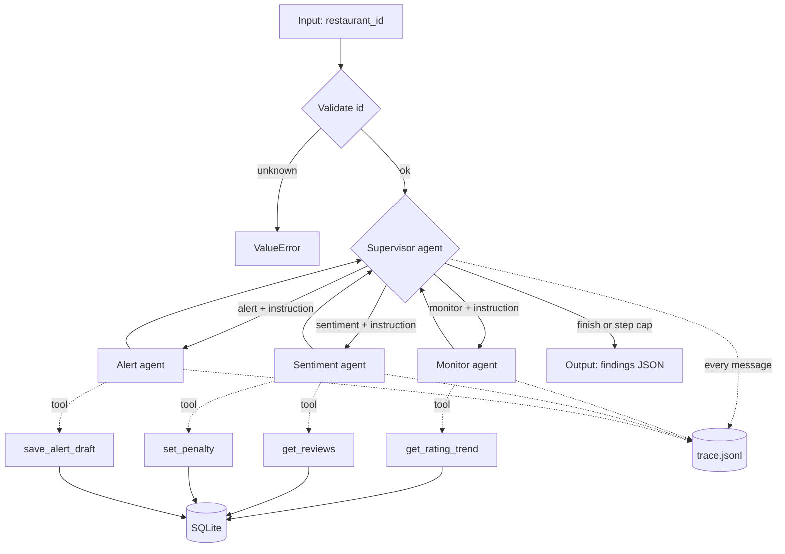

# SmartBite AI: Design Document

## 1. Architecture



Shared state (LangGraph `State`): `restaurant_id`, `findings` (agent name to a list of results), `steps`, `next`, `instruction`.

## 2. Orchestration pattern

**Orchestrator-worker with a supervisor loop.** Every worker returns to the Supervisor and workers never talk to each other directly. The Supervisor is an LLM call with a structured output (`next`, `reason`, `instruction`), so routing is decided by the model from the findings, not by hard-coded edges. The only fixed rule in code is `MAX_STEPS = 8`.

Justification: we need cross-checking (numbers vs text) and conditional follow-up (alert only if confirmed). A central decider keeps that logic in one place, makes the trace easy to read, and lets us bound the run. Peer-to-peer would make it harder to guarantee termination.

## 3. Agent roles

| Agent | Responsibility | Decides | Tools | Output |
|---|---|---|---|---|
| Supervisor | Plan, route, arbitrate, stop | Which worker next, with what instruction, or finish | none (structured decision) | `{next, reason, instruction}` |
| Monitor | Is the rating drop real? | Whether the sample is big enough; may call the tool again with a different window | `get_rating_trend` | drop, severity, confidence, needs_verification |
| Sentiment | Is review text turning negative? | Whether to fetch more reviews; whether and how hard to penalise | `get_reviews`, `set_penalty` | sentiment, trend, confidence, penalty_applied, evidence |
| Alert | Tell the owner, with evidence | Whether an alert is warranted at all | `save_alert_draft` | alert_drafted, alert_id, summary |

Agentic behaviour: each worker runs a tool-calling loop (`agents/base.py`) where the LLM chooses which tool to call and when to stop. The Supervisor changes the plan based on results: it re-runs a worker when confidence is low or the workers disagree, retries after an error, and skips the Alert agent when there is no decline.

Failure handling: a worker exception becomes `{"error": ...}` in the findings and the Supervisor decides whether to retry or finish. A supervisor failure ends the run. Invalid restaurant ids are rejected before any agent runs. A tool error inside an agent is returned to the LLM as a tool message.

## 4. Technology choices

| Choice | Why |
|---|---|
| LangGraph | Native support for a cyclic supervisor/worker graph with shared state; the loop back to the Supervisor is a plain edge |
| LangChain tools | One decorator turns a Python function into a typed tool the LLM can call |
| Groq, `openai/gpt-oss-120b` | Fast, free-tier friendly, supports tool calling and JSON-schema output. Swappable in `lib/llm.py` via the `MODEL` env var |
| SQLite | Zero setup, enough for 300 restaurants and 8,000 reviews |
| scikit-learn TF-IDF | Cheap, explainable text match for the recommender; the agents change its output through the penalties table |
| Streamlit | Fastest way to a live UI with an approval workflow |

## 5. Input definition

The system accepts one integer.

```json
{ "restaurant_id": 2 }
```

| Field | Type | Rules |
|---|---|---|
| `restaurant_id` | integer | Must exist in `restaurants`; otherwise `ValueError: unknown restaurant id` |

Entry points: `python -m agents.graph <restaurant_id>` and the "Run multi-agent analysis" button in `app.py`.

Real sample: `python -m agents.graph 2`

## 6. Output definition

The graph returns `findings`, a dict keyed by agent name. Each value is a list, one entry per run of that agent.

```json
{
  "monitor": [
    {
      "restaurant_id": 2,
      "drop": true,
      "severity": "high",
      "confidence": 0.86,
      "needs_verification": false,
      "reason": "Significant -0.68 drop with sufficient recent reviews"
    }
  ],
  "sentiment": [
    {
      "restaurant_id": 2,
      "sentiment": "negative",
      "trend": "declining",
      "confidence": 0.86,
      "penalty_applied": 0.6,
      "evidence": [
        "Quality has dropped badly, used to be so much better.",
        "Very disappointing, dirty tables and bland food.",
        "Found a hair in my dish. Never coming back."
      ]
    }
  ],
  "alert": [
    {
      "restaurant_id": 2,
      "alert_drafted": true,
      "alert_id": 2,
      "summary": "Rating down 0.68 (high severity, 86% confidence) and negative sentiment trend (86% confidence) with complaints about dirty tables, cold food, hair in dish, and rude staff."
    }
  ]
}
```

| Field | Type | Meaning |
|---|---|---|
| `monitor.drop` | bool | A real rating drop was detected |
| `monitor.severity` | none / low / medium / high | Size of the drop |
| `*.confidence` | float 0 to 1 | The agent's own certainty |
| `sentiment.penalty_applied` | float or null | Ranking penalty written to the `penalties` table |
| `alert.alert_id` | int or null | Row in `alerts`, status `pending` until a human approves |
| `error` | string | Present instead of the fields above if that agent crashed |

Side effects: a row in `penalties` (changes recommendation ranking), a row in `alerts`, and trace records in `trace.jsonl`.

Execution trace record (one JSON object per line):

```json
{"run_id": "ab12cd34", "ts": "2026-10-12T08:01:02+00:00", "from": "supervisor", "to": "monitor", "reason": "Initial step: start with monitor to check for rating decline.", "content": {"instruction": ""}}
```

## 7. Evidence of agentic behaviour

Two real runs are in this folder:

- `sample_trace_decline.jsonl`: restaurant 2 after 10 injected bad reviews. Path: supervisor, monitor, sentiment (applies a 0.6 penalty), alert, finish.
- `sample_trace_healthy.jsonl`: restaurant 3, no incident. The Supervisor dispatched monitor and sentiment, then **re-ran sentiment** because its confidence was lower than the monitor's, and finished without an alert. The path differs from the first run because the Supervisor reasoned from the findings.

## 8. Known limits

- The Monitor and Sentiment agents read the same reviews table, so they are two views of the same data rather than independent sources.
- Review dates and user ids in the demo data are synthetic.
- The LLM can be noisy, for example reporting `positive` sentiment with a `declining` trend. The confidence fields and the Supervisor's re-run rule exist to catch this.
- Alerts are drafted and stored but not actually sent; that is intentional (human approval).
